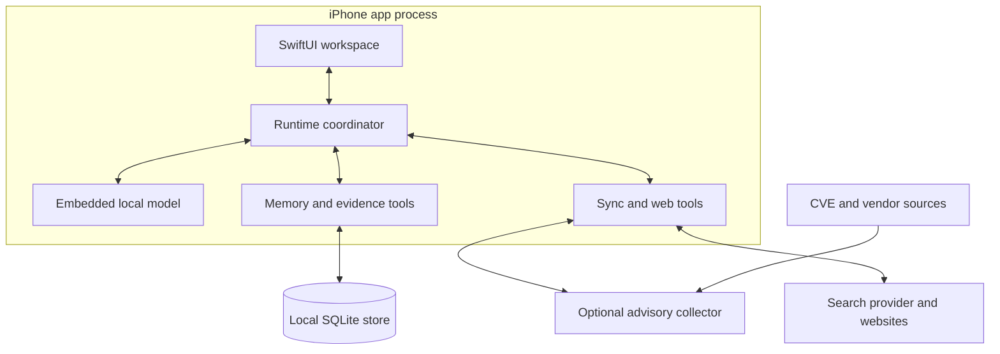

# Proposed architecture

Design baseline: 2026-10-07. Names below are proposed module boundaries, not implemented APIs.

## Process and platform model

The iPhone app process hosts SwiftUI, a Swift runtime coordinator, an embedded inference library, and local memory/tool services. Run inference off the UI thread. A Swift actor serializes model lifecycle and generation access; it is not a separate OS process. No local HTTP server is required for in-app inference.

The OS can suspend or terminate the entire app. Persist completed work and task checkpoints incrementally. Resume from committed state and reconcile outstanding external operations before retrying. Background-task APIs provide supported opportunities to work, not a permanent process or exact hourly scheduler.

An optional collector operates independently on an always-available host. It prepares advisory updates on an hourly product cadence while obeying each source's own polling and rate-limit requirements. The app fetches deltas on foreground entry and eligible background opportunities. Push messages are optional hints, not proof the phone has refreshed.

Patch execution is a separate authenticated management integration. Its job state remains durable in that management system or execution service; the local model never directly defines the platform's authority.

## Components

| Component | Responsibility |
| --- | --- |
| App UI | Setup, briefing, conversation, finding details, memory controls, tasks, and settings |
| Runtime coordinator | Model load/unload, context construction, validated tool calls, cancellation, budgets, checkpoints |
| Inference adapter | Stable Swift-facing interface around embedded llama.cpp; supports a benchmark-driven model choice |
| Memory service | Scoped retrieval and validated proposals for additions, corrections, consolidation, and forgetting |
| Evidence store | Versioned advisories, inventory observations, findings, source snapshots, and timestamps |
| Applicability engine | Vendor-aware matching of product, version, build, package, configuration, and evidence freshness |
| Priority engine | Deterministic, explainable prioritization inputs; published severity remains distinct |
| Briefing builder | Changed-since-last-view selection, deduplication, outstanding priorities, factual counts |
| Sync client | Cursor-based delta application, idempotency, retry/backoff, stale-state reporting |
| Web tools | Search and document retrieval with source attribution and bounded outputs |
| Remediation planner | Authoritative fixes, exact target plans, prerequisites, staged verification, recovery options |
| Connector adapters | Optional inventory and later patch execution via supported management interfaces |

## Local inference

Use an embedded llama.cpp XCFramework/compatible build with Metal as the initial candidate. Keep the adapter replaceable if measured MLX or other supported execution proves preferable. Choose model architecture, quantization, tool format, and context length through physical-device evaluation.

Account for model weights, KV cache, embeddings, SQLite indexes, UI, and system pressure together. Support cancellation, timeouts, thermal/memory-pressure response, context compaction, and unloading. Begin with one generation at a time; multiple task records do not require parallel resident models.

Pin inference dependencies after compatibility review. Validate model licenses, download provenance, expected hashes, disk capacity, partial downloads, and user removal. Do not commit model weights. The user must be able to see when the model is loading, running, unavailable, or paused.

## Durable data design

The following are logical entities, not a final SQL schema:

| Entity | Essential information |
| --- | --- |
| EnvironmentProfile | Identity, OS/products, hosting/services, preferences, scope |
| AssetObservation | Asset identity, product/build/package versions, configuration, observed time, source |
| AdvisoryRevision | CVE/advisory identity, revision, affected conditions, severity, references, publication/modification time |
| SourceSnapshot | Source identity, fetched time, upstream revision/URL, parse status, content hash |
| Finding | Profile/asset, advisory revision, applicability, match reason, evidence IDs, evaluation time |
| PriorityAssessment | Finding, input signal revisions, priority, explanation, assessment time |
| MemoryRecord | Scope, kind, content, source IDs, confirmation label, creation/update time, supersedes/deletion state |
| ConversationEvent | Session, message/tool event, event time, permitted source links |
| TaskCheckpoint | Task, committed step, status, external operation ID, resumable data |
| RemediationPlan | Revision, targets, official fix references, prerequisites, approval, execution/verification state |
| SyncState | Source cursor, last success, attempted refresh, retry state, partial-failure metadata |

Use transactions and migrations. Maintain FTS5 for lexical retrieval and a separately versioned embedding/index component for semantic retrieval. FTS5 itself is not semantic search. Retain raw/source facts separately from summaries so interpretation can be rebuilt when logic or upstream data changes.

Apply platform data protection to local stores and Keychain-backed handling for credentials. Decide explicit backup/export, encryption, retention, and key-lifecycle requirements during review. Do not describe plain SQLite as automatically application-encrypted.

## Memory lifecycle

Capture permitted events, propose candidate facts, validate scope and provenance, commit a version, retrieve only relevant active records, and consolidate when execution resources permit. Use labels such as user-confirmed, source-supported, or inferred instead of uncalibrated numeric confidence.

On correction, supersede the old record and invalidate derived summaries/index entries. On forgetting, remove or invalidate all retrieval paths, including embeddings and cached summaries; prevent replay from reconstructing deleted personal facts. Preserve only explicitly documented minimal deletion/audit metadata and honor retention policy. Do not claim cryptographic erasure across backups without implementing it.

Store unfinished task state independently from chat summaries. A restart should recover the last committed step, not attempt to reconstruct external side effects from prose.

## Ingestion and synchronization

The collector normalizes original CVE records, enrichment, exploitation signals, and vendor advisories with source-specific adapters. Persist cursors only after a successful transactional import; handle overlapping windows, pagination, duplicates, revisions, and rejected records. Use conditional requests where supported, retry with backoff, honor rate limits, and surface source-specific failures.

Hourly is the product update target, not a guarantee that every upstream source changes hourly. FIRST EPSS is a dated daily signal. Re-check NVD and other source usage guidance during implementation rather than imposing one polling rate everywhere.

The phone consumes bounded, resumable deltas rather than loading the whole vulnerability corpus into the model. Missing NVD enrichment must not hide a valid new CVE. Retain last-success timestamps per source and an explicit partial-sync state. The generic advisory collector need not receive private inventory; applicability can remain local for the initial design.

## Matching and explanation

Normalize vendor/product identities and preserve original inventory values. Apply version logic appropriate to the vendor, package ecosystem, and affected-condition expressions. Do not use naive lexical ordering, generic semantic-version rules for every ecosystem, or a fuzzy product name alone to establish affected status. Account for distro backports, Windows build/update applicability, and patch supersedence using authoritative evidence.

Unknown versions, ambiguous products, stale inventory, and contradictory advisories remain explicit. Reevaluate when evidence changes. AI can suggest a mapping for review and summarize evidence; deterministic evaluated records control statuses and counts.

## Web research and tools

Define typed tool inputs/outputs with validation, deadlines, bounded results, and source references. Keep web content distinct from user instructions and system/tool policy. Retrieved content cannot authorize a patch or memory-policy change. Avoid leaking private inventory into search queries; keep provider credentials out of prompts, logs, and distributable app secrets.

Track visited sources and explain retrieval failures. User-facing search results should distinguish current retrieval from cached evidence. No cloud-model fallback should occur without an explicit product setting and disclosure; the baseline remains local inference.

## Remediation execution, later milestone

Keep inventory-reading and patch-writing permissions separate. Store approval against a specific plan revision and target set. Use connector-supported actions, durable idempotency keys/job IDs, staged rollouts, maintenance windows, stop conditions, and documented recovery where supported. Reconcile job state after interruptions before repeating an action.

Verify installed update/package state and service health after execution. Pending reboot, unobserved hosts, and partial completion remain pending or failed as appropriate. Persist evidence of verified resolution and update applicability; a model-generated success sentence cannot change that state.

## Candidate source layout

| Future path | Intended contents |
| --- | --- |
| `ios/` | Native app project and UI |
| `Packages/AppCore/` | Domain models, storage, matching, memory, and protocol seams |
| `Packages/LocalInference/` | Swift adapter and pinned inference dependency |
| `collector/` | Optional feed service after language/hosting decision |
| `fixtures/` | Clearly synthetic advisory/inventory examples |
| `docs/` | Product, architecture, decisions, and validation evidence |

Do not scaffold empty implementations merely to match this layout. Add modules as their milestones become actionable.
